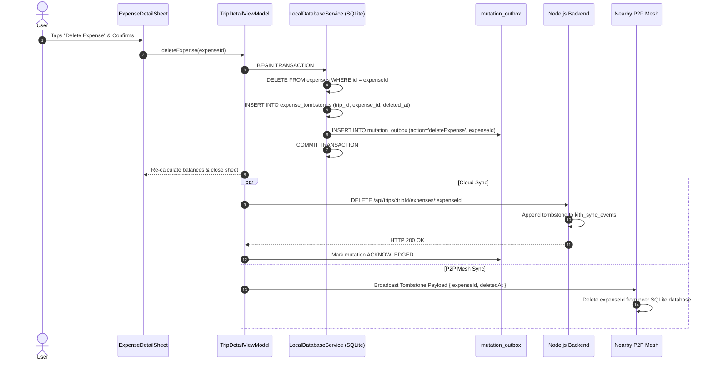

# Complete Data Flow & Mutation Lifecycles
**Project:** SplitTrip (KITH)  
**Scope:** Full Client-to-Backend-to-Database Data Lifecycle  
**Author:** Principal Software Architect & QA Systems Engineer  
**Date:** 2026-11-19  

---

## 1. Universal End-to-End Lifecycle Pattern

Every state mutation in SplitTrip adheres to the following deterministic 11-stage pipeline:

```
[1. USER ACTION] 
  └─ User interacts with UI (e.g., tap "Save Expense").
[2. INPUT VALIDATION] 
  └─ Pure engines validate format, constraints, and balance parity.
[3. BUSINESS LOGIC] 
  └─ Assign client UUID v4, deterministic ISO-8601 UTC timestamp, and optimistic net balance.
[4. LOCAL PERSISTENCE] 
  └─ Immediate atomic SQLite transaction commits entity to local relational table.
[5. PENDING OPERATION ENQUEUE] 
  └─ Mutation enqueued to 'mutation_outbox' with idempotency key and checksum (syncState = localPending).
[6. OPTIMISTIC UI REFRESH] 
  └─ UI updates instantly via SQLite stream observer; badge shows "Saved Locally".
[7. NETWORK DISPATCH] 
  └─ SyncService dispatches payload to Node.js backend over HTTPS / WebSocket.
[8. SERVER VALIDATION & LOCKING] 
  └─ Backend validates token, verifies trip membership (IDOR check), and acquires pg_advisory_xact_lock.
[9. DATABASE TRANSACTION] 
  └─ PostgreSQL transaction commits entity, updates wall-clock timestamp, and appends to kith_sync_events.
[10. REALTIME BROADCAST & ACK] 
  └─ Backend sends 201 Created to caller and broadcasts event to WebSocket room subscribers.
[11. LOCAL RECONCILIATION] 
  └─ Client marks outbox mutation ACKNOWLEDGED; updates entity syncState = synced; UI badge turns green.
```

---

## 2. Detailed Data Flow by Core User Feature

### 2.1 Feature: Add Expense (Multi-Payer Custom Allocations)

```mermaid
sequenceDiagram
    autonumber
    actor User
    participant View as AddExpenseScreen
    participant VM as AddExpenseViewModel
    participant ME as MoneyEngine / BalanceEngine
    participant DB as LocalDatabaseService (SQLite)
    participant Outbox as mutation_outbox
    participant API as Node.js Backend (/api/trips/:id/expenses)
    participant PG as PostgreSQL (Supabase)
    participant WSH as WebSocket Hub

    User->>View: Enters Title, ₹200 Total, Selects Payers & Splits
    View->>VM: submitExpense()
    VM->>ME: validateSplits(total: 200, splits, paidByMap)
    alt Imbalanced Splits or Payers != Total
        ME-->>VM: ValidationError("Sum of splits must equal ₹200")
        VM-->>View: Display error banner (No database write)
    else Valid Allocation
        ME-->>VM: OK
        VM->>DB: BEGIN TRANSACTION
        DB->>DB: INSERT INTO expenses (id, trip_id, title, amount, raw_json)
        DB->>Outbox: INSERT INTO mutation_outbox (id, action='addExpense', payload, idempotency_key)
        DB->>DB: COMMIT TRANSACTION
        DB-->>VM: Success
        VM-->>View: Pop sheet & emit optimistic TripModel ("Saved Locally")
        
        opt Device is Online
            VM->>API: POST /api/trips/:tripId/expenses (with x-kith-session-token)
            API->>API: Authenticate & Verify Trip Membership
            API->>PG: BEGIN; SELECT pg_advisory_xact_lock(tripId);
            PG->>PG: INSERT INTO expenses ... ON CONFLICT (id) DO UPDATE ...
            PG->>PG: INSERT INTO kith_sync_events (seq, trip_id, action='EXPENSE_CREATED')
            PG->>PG: COMMIT;
            API->>WSH: broadcastToRoom(tripId, 'EXPENSE_CREATED')
            API-->>VM: HTTP 201 Created (Canonical Expense)
            VM->>Outbox: UPDATE mutation_outbox SET status='acknowledged' WHERE id=?
            VM->>DB: UPDATE expenses SET revision=?, sync_state='synced' WHERE id=?
            VM-->>View: Sync indicator updates to "Synced"
        end
    end
```

### 2.2 Feature: Join Trip (Invite Code & QR Code)

```mermaid
sequenceDiagram
    autonumber
    actor User
    participant View as JoinTripScreen
    participant VM as JoinTripViewModel
    participant API as Node.js Backend (/api/trips/join)
    participant DB as LocalDatabaseService (SQLite)

    User->>View: Enters 6-character Invite Code (e.g. "K7X9PQ")
    View->>VM: joinTrip(code)
    alt Offline Mode
        VM-->>View: ApplicationError(NetworkError: "Cannot join new trip while offline")
    else Online Mode
        VM->>API: POST /api/trips/join { inviteCode: "K7X9PQ", user }
        API->>API: Lookup trip by inviteCode; Verify not already a member
        API->>API: Create trip_member record & assign role='member'
        API-->>VM: HTTP 200 OK { trip: TripModel, member: MemberModel }
        VM->>DB: BEGIN TRANSACTION
        DB->>DB: INSERT OR REPLACE INTO trips (...)
        DB->>DB: INSERT OR REPLACE INTO trip_members (...)
        DB->>DB: COMMIT TRANSACTION
        VM-->>View: Navigate to TripDetailScreen(tripId)
    end
```

### 2.3 Feature: Delete Expense (Offline Tombstone Propagation)



### 2.4 Feature: Record Settlement (Cash & UPI Deep Link)

```mermaid
sequenceDiagram
    autonumber
    actor Debtor
    actor Creditor
    participant View as SettleUpView
    participant VM as TripDetailViewModel
    participant UPI as External UPI App (GPay / PhonePe)
    participant DB as LocalDatabaseService (SQLite)
    participant API as Node.js Backend (/api/trips/:id/settlements)

    Debtor->>View: Selects Creditor & Enters Amount (₹500)
    alt Chooses UPI
        View->>UPI: Launches UPI URI: upi://pay?pa=creditor@upi&pn=Creditor&am=500.00
        UPI-->>Debtor: User completes banking transfer
    end
    Debtor->>View: Taps "Record Payment"
    View->>VM: recordSettlement(fromMemberId, toMemberId, 500)
    VM->>DB: BEGIN TRANSACTION
    DB->>DB: INSERT INTO settlements (id, trip_id, from_id, to_id, amount, is_settled=1)
    DB->>DB: INSERT INTO mutation_outbox (action='recordTripSettlement')
    DB->>DB: COMMIT TRANSACTION
    VM-->>View: Balances recalculate; debt reduced by ₹500
    VM->>API: POST /api/trips/:id/settlements
    API->>API: Record payment & notify Creditor device via FCM
    API-->>VM: HTTP 201 Created
```

### 2.5 Feature: Smart Trip Completion & Late Expense Reconciliation

1. **Completion Check**:
   - Creator requests trip completion.
   - `TripService` checks whether any participant has pending unacknowledged mutations or whether balances are unsettled.
   - If unsynced members exist, prompt user: "2 members have unsynced expenses. Force close anyway or wait?"
2. **Late Offline Expense Handling**:
   - If a member who was offline for 3 days comes back online with an expense created prior to trip completion:
   - The backend accepts the late expense, temporarily marks trip `lifecycleState = 'completed_with_pending_changes'`, recalculates final balances, and notifies all members.
   - No data is silently dropped.

---

## 3. Potential Failure Points & Built-In Defenses

| Failure Mode | Point of Failure | System Defense |
| :--- | :--- | :--- |
| **Crash during write** | Between memory calculation and disk save | Atomic SQLite WAL transactions guarantee that writes either commit completely or roll back. |
| **Network drop mid-POST** | After server receives request, before client receives ACK | Client generated UUID v4 and idempotency keys ensure retried POSTs do not create duplicate records. |
| **Simultaneous edits** | Two members edit the same expense offline | Revision numbers detect conflict (HTTP 409). Reconciliation engine performs non-destructive merge or flags for review. |
| **Stale resurrection** | Offline peer sync brings back a deleted expense | `expense_tombstones` with deterministic timestamps prevent resurrected items from overwriting deletions. |
| **Account switch leak** | New guest logs in on same device | `clearAllUserData()` explicitly purges SQLite tables, SharedPreferences, and in-memory caches. |
