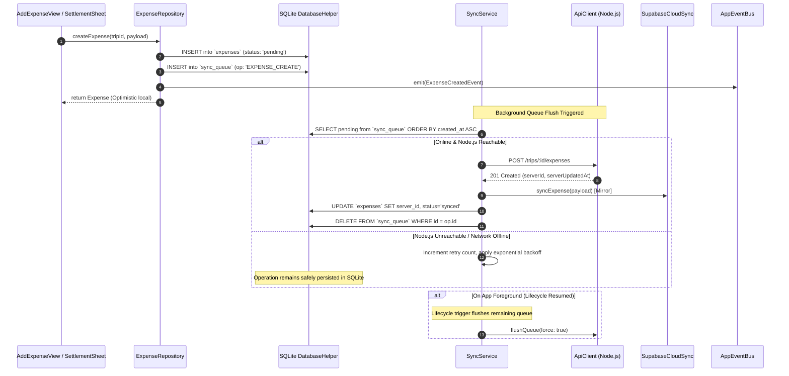

# Component Connection Map: Architectural Topology & Integration Boundaries

**Project:** SplitTrip (`kith_app`)  
**Package:** `com.nirniq.kith`  
**Version:** 1.0.0+1  
**Audit Date:** 2026-11-19  

---

## 1. Global Architectural Topology & Seams

The following diagram maps every architectural tier in the SplitTrip application, illustrating the intended data flow versus the **actual discovered seams, bypassed providers, and disconnected boundaries**.

```mermaid
flowchart TD
    %% Presentation Tier
    subgraph UI_Tier["1. PRESENTATION TIER (Views, Sheets & Dialogs)"]
        OV["OnboardingView"]
        HV["HomeView\n(DashboardTab, TripsHomeTab, ProfileHomeTab)"]
        CTV["CreateTripView / JoinTripView"]
        TDV["TripDetailView\n(Expenses, Balances, Timeline)"]
        AEV["AddExpenseView"]
        SS["SettlementSheet / PaymentVerificationDialog"]
        MMV["ManageMembersView"]
        MSV["MasterSettingsView / CloudSettingsView"]
        
        %% Disconnected / Orphaned Views
        subgraph Orphaned_Views["Orphaned / Disconnected Views"]
            style Orphaned_Views fill:#ffebee,stroke:#c62828,stroke-dasharray: 5 5
            SUV["SettleUpView\n(Hardcoded Rohan/Priya/Karan)"]
            AHT["ActivityHomeTab\n(Hardcoded Aman/Priya Feed)"]
            SEV["SplitExpenseView\n(Inline split duplicated)"]
            AJSS["AddJourneyStopSheet\n(0 Callers in UI)"]
            ATMS["AddTripMemorySheet\n(Superseded)"]
            TPV["TripPreviewView\n(Route exists, 0 links)"]
            ASV["AdminShellView\n(Route exists, 0 UI entry)"]
        end
    end

    %% State Management Tier
    subgraph State_Tier["2. STATE MANAGEMENT TIER (ChangeNotifier & Providers)"]
        AVM["AuthViewModel"]
        HVM["HomeViewModel"]
        CTVM["CreateTripViewModel"]
        TDVM["TripDetailViewModel"]
        LVM["LocaleViewModel"]
        PS["PaymentService\n(Provider in main.dart)"]
        VVM["VersionViewModel"]
    end

    %% Repository Tier
    subgraph Repo_Tier["3. REPOSITORY & DOMAIN TIER"]
        UR["UserRepository"]
        TR["TripRepository"]
        ER["ExpenseRepository"]
        NSR["NirniqSyncRepository"]
    end

    %% Local Storage Tier
    subgraph Local_Tier["4. LOCAL PERSISTENCE & CACHE TIER"]
        SQL["SQLite DatabaseHelper\n(trips, expenses, sync_queue)"]
        LSS["LocalStorageService\n(SharedPreferences)"]
        FSS["FlutterSecureStorage\n(Private Keys, Session Tokens)"]
    end

    %% Sync & Transport Tier
    subgraph Sync_Tier["5. SYNC & TRANSPORT TIER"]
        SSER["SyncService\n(Operation Queue Manager)"]
        P2P["P2PSyncService\n(Nearby BLE / Wi-Fi Direct)"]
        API["ApiClient\n(Node.js REST Client)"]
        SCS["SupabaseCloudSync\n(PostgREST & Storage)"]
        RTC["RealtimeClient\n(WebSocket Stream)"]
    end

    %% Backend Tier
    subgraph Backend_Tier["6. REMOTE BACKEND & CLOUD TIER"]
        subgraph Node_Backend["Node.js REST Services"]
            NTS["trip_service.js"]
            NES["expense_service.js"]
            NSS["settlement_service.js"]
            JDB["Ephemeral database.js\n(JSON file storage)"]
            PGA["PostgresAdapter\n(Bypassed in Node backend)"]
        end
        SUPA["Supabase Cloud Database\n(PostgreSQL + RLS)"]
        PG["PostgreSQL Server Database"]
    end

    %% Normal Connections
    OV -->|Normal Guest Sign-In| AVM
    AVM --> UR
    UR --> SQL
    UR --> FSS
    UR --> API

    HV --> HVM
    HVM --> TR
    CTV --> CTVM
    CTVM --> TR
    TDV --> TDVM
    TDVM --> TR
    TDVM --> ER

    AEV --> ER
    ER --> SQL
    ER --> SSER
    TR --> SQL
    TR --> SSER

    SSER --> API
    SSER --> SCS

    %% Disconnection & Bypassed Connections (Highlighted with Red/Dotted)
    OV -.->|CRITICAL BUG: Bypasses AuthViewModel| NIS["NirniqIdentityServiceImpl"]
    NIS -.->|Direct Route Push| HV

    SS -.->|CRITICAL BYPASS: Instantiates new PaymentService()| PS_DEAD["Private PaymentService()"]
    MSV -.->|CRITICAL BYPASS: Directly instantiates| FEBS["FinanceExportBridgeService"]

    TDV -.->|Raw Navigator.push (Bypasses GoRouter)| MMV

    AEV -.->|State Disconnect: Does NOT notify| HVM
    CTVM -.->|State Disconnect: Does NOT reload| HVM

    API --> NTS & NES & NSS
    NTS & NES & NSS -->|CRITICAL DATA LOSS RISK: Writes to JSON| JDB
    NTS & NES & NSS -.-x|BYPASSED: Never writes to Postgres| PGA
    PGA -.-> PG

    SCS --> SUPA
    ER & TR -.-x|SPLIT BRAIN: Never queries Supabase for reads| SCS

    linkStyle 17 stroke:#e53935,stroke-width:3px,stroke-dasharray: 4 4;
    linkStyle 18 stroke:#e53935,stroke-width:3px,stroke-dasharray: 4 4;
    linkStyle 19 stroke:#e53935,stroke-width:3px,stroke-dasharray: 4 4;
    linkStyle 20 stroke:#e53935,stroke-width:3px,stroke-dasharray: 4 4;
    linkStyle 21 stroke:#e53935,stroke-width:3px,stroke-dasharray: 4 4;
    linkStyle 22 stroke:#e53935,stroke-width:3px,stroke-dasharray: 4 4;
    linkStyle 23 stroke:#e53935,stroke-width:3px,stroke-dasharray: 4 4;
    linkStyle 26 stroke:#e53935,stroke-width:3px,stroke-dasharray: 4 4;
    linkStyle 28 stroke:#e53935,stroke-width:3px,stroke-dasharray: 4 4;
```

---

## 2. Authentication & Nirniq SSO Connection Map

### Current Broken Implementation:
```
[User Taps 'Continue with Nirniq' in OnboardingView]
         │
         ▼
OnboardingView._handleNirniqSignIn()
         │  (Instantiates new NirniqIdentityServiceImpl directly)
         ▼
NirniqIdentityServiceImpl.authenticateWithNirniq()
         │  (Returns NirniqUser successfully)
         ▼
context.go('/home') ───► [AuthViewModel.currentUser IS STILL NULL!]
                                │
                                ▼
                         HomeView checks authVm.currentUser
                                │
                                ▼ (Redirects)
                         context.go('/onboarding') [INFINITE LOOP!]
```

### Correct Architectural Connection:
```
[User Taps 'Continue with Nirniq' in OnboardingView]
         │
         ▼
AuthProgressDialog.startNirniqSignIn(context)
         │
         ▼
context.read<AuthViewModel>().signInWithNirniq()
         │
         ▼
UserRepository.authenticateWithNirniq()
         │
         ├──► NirniqIdentityService.authenticateWithNirniq()
         ├──► Save user session token to FlutterSecureStorage
         ├──► Upsert user entity into SQLite database
         └──► Register/Update user in Supabase & Node.js API
         │
         ▼
AuthViewModel.setCurrentUser(user) ───► notifyListeners()
         │
         ▼
context.go('/home') ───► HomeView mounts with valid authVm.currentUser (SUCCESS!)
```

---

## 3. Expense Creation & Realtime Distribution Map

### Current Partial Implementation:
```
AddExpenseView (Save Expense)
         │
         ▼
ExpenseRepository.createExpense()
         │
         ├──► Inserts into SQLite `expenses` table
         └──► Enqueues operation in `sync_queue`
         │
         ▼
AddExpenseView pops with `Navigator.pop(context, true)`
         │
         ├──► TripDetailView receives `true` -> Reloads trip expenses (LOCAL SUCCESS)
         └──x [HomeViewModel IS NEVER NOTIFIED!] -> Home Dashboard shows stale total!
```

### Correct Architectural Connection:
```
AddExpenseView (Save Expense)
         │
         ▼
ExpenseRepository.createExpense()
         │
         ├──► Inserts into local SQLite `expenses` table
         ├──► Enqueues sync operation into `sync_queue`
         ├──► SyncService triggers immediate background push to Node.js & Supabase
         │
         └──► Emits `AppEvent.expenseCreated(expense)` on EventBus
                   │
                   ├──► TripDetailViewModel updates in-memory list & recalculates debts
                   └──► HomeViewModel recalculates aggregate spending across trips
                             │
                             ▼
                   Both screens re-render reactively with zero lag
```

---

## 4. Settlement & UPI Payment Flow Map

### Current Broken Implementation:
```
SettlementSheet (Initiate Payment)
         │  (Directly instantiates `_paymentService = PaymentService()`)
         ▼
Private PaymentService (Bypasses ChangeNotifierProvider in main.dart)
         │
         ├──► Launches UPI app via deep link (`upi://pay?...`)
         └──► User approves transaction in PhonePe / GPay
         │
         ▼
Returns to app -> Private PaymentService has no global listeners
         │
         ▼
ExpenseRepository.createSettlement()
         │
         └──► Enqueued into sync_queue as generic 'EXPENSE_CREATE' (Fields lost!)
```

### Correct Architectural Connection:
```
SettlementSheet (Initiate Payment)
         │
         ▼
context.read<PaymentService>().initiateSettlementPayment(...)
         │
         ├──► Broadcasts PaymentInitiated event to global listeners
         ├──► Launches native UPI application
         ├──► Verifies transaction reference via PaymentVerificationDialog
         │
         ▼
Payment confirmed
         │
         ▼
ExpenseRepository.createSettlement(...)
         │
         ├──► Records settlement in local SQLite `settlements` table
         └──► Enqueues `OperationType.createSettlement` in sync_queue
                   │
                   ▼
         SyncService flushes directly to `/api/v1/trips/:id/settlements`
                   │
                   ▼
         Backend SettlementService processes settlement & simplifies debts
```

---

## 5. Offline Sync Queue & Reconciliation Map



---

## 6. Target Unified Connection Topology

The following diagram defines the **clean, target architecture** once all 10 critical issues are resolved:

```mermaid
graph TD
    subgraph Presentation["Presentation Layer (GoRouter Only)"]
        V_Auth["OnboardingView"]
        V_Home["HomeView"]
        V_Trip["TripDetailView"]
        V_Exp["AddExpenseView"]
        V_Settle["SettlementSheet"]
        V_Members["ManageMembersView"]
    end

    subgraph State["State Management Layer (Provider + EventBus)"]
        VM_Auth["AuthViewModel"]
        VM_Home["HomeViewModel"]
        VM_Trip["TripDetailViewModel"]
        SVC_Pay["PaymentService (Managed Provider)"]
        BUS["AppEventBus (Reactive Stream)"]
    end

    subgraph Domain["Domain & Repository Layer"]
        R_User["UserRepository"]
        R_Trip["TripRepository"]
        R_Exp["ExpenseRepository"]
        R_Settle["SettlementRepository"]
    end

    subgraph Persistence["Local Storage Layer"]
        L_SQL["SQLite (Single Source of Offline Truth)"]
        L_Sec["FlutterSecureStorage (Encrypted Tokens)"]
        L_Pref["LocalStorageService (Preferences)"]
    end

    subgraph SyncEngine["Sync & Connectivity Layer"]
        S_Sync["SyncService (Lifecycle & Network Aware)"]
        S_Real["RealtimeClient (WebSocket)"]
    end

    subgraph Cloud["Remote Cloud Layer (Dual Failover)"]
        C_Node["Node.js Primary REST API"]
        C_PG["PostgreSQL (ACID Server DB)"]
        C_Supa["Supabase (Realtime + Fallback Storage)"]
    end

    %% Wiring
    V_Auth --> VM_Auth
    V_Home --> VM_Home
    V_Trip --> VM_Trip
    V_Exp --> VM_Trip
    V_Settle --> SVC_Pay
    V_Members --> VM_Trip

    VM_Auth --> R_User
    VM_Home --> R_Trip
    VM_Trip --> R_Trip & R_Exp & R_Settle

    R_Exp -.->|Publish Mutations| BUS
    BUS -.->|Subscribe| VM_Home
    BUS -.->|Subscribe| VM_Trip

    R_User & R_Trip & R_Exp & R_Settle --> L_SQL
    R_User --> L_Sec

    R_Trip & R_Exp --> S_Sync
    S_Sync --> C_Node
    C_Node --> C_PG
    S_Sync --> C_Supa

    S_Real --> VM_Trip
