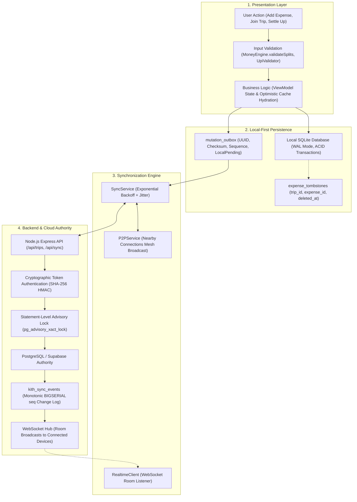

# Data Flow Architecture & Lifecycle Specification

**Project:** SplitTrip (KITH)  
**Package:** `com.nirniq.kith` (`kith_app`)  
**Backend:** Node.js/Express, PostgreSQL/Supabase, WebSocket Hub  
**Local Database:** SQLite WAL Mode (`LocalDatabaseService`) + SharedPreferences Fallback (`LocalStorageService`)  
**Status:** Validated & Production-Hardened  

---

## 1. End-to-End Architectural Topology

SplitTrip implements an offline-first, local-authoritative data lifecycle. Every user interaction is persisted locally before network dispatch is attempted, preventing data loss during network drops or app terminations.



---

## 2. The 11-Stage Expense Lifecycle

Every financial mutation follows this deterministic 11-stage pipeline:

```
[1. USER ACTION]
     │ User enters amount, title, multi-payer contributions, and splits.
     ▼
[2. INPUT VALIDATION]
     │ Client validates: amount > 0, sum(splits) == total == sum(paidByMap).
     │ Rejects fractional paise imbalances or non-participating members.
     ▼
[3. BUSINESS LOGIC]
     │ AddExpenseViewModel assigns client UUID v4, deterministic UTC timestamp.
     │ Computes initial BalanceEngine net balances in memory.
     ▼
[4. LOCAL DATABASE]
     │ LocalDatabaseService executes atomic SQLite transaction:
     │ Upserts record into 'expenses' table; registers audit log.
     ▼
[5. PENDING SYNC QUEUE]
     │ Enqueues SyncMutation into 'mutation_outbox' with idempotency_key,
     │ payload checksum, and syncState = 'localPending'.
     ▼
[6. SUPABASE / NODE API]
     │ Dispatches via HTTPS to POST /api/trips/:tripId/expenses.
     │ Passes cryptographic session token in 'x-kith-session-token'.
     ▼
[7. SERVER VALIDATION]
     │ Node.js verifies session token, trip membership, and split parity.
     │ Verifies caller has permission to mutate expenses on this trip.
     ▼
[8. SERVER DATABASE]
     │ PostgreSQL transaction acquires advisory lock, inserts/upserts expense.
     │ kith_set_updated_at() trigger stamps true wall-clock clock_timestamp().
     │ kith_log_sync_event() inserts immutable event into 'kith_sync_events'.
     ▼
[9. SYNC ACKNOWLEDGEMENT]
     │ Server returns HTTP 201 Created with canonical expense JSON.
     ▼
[10. LOCAL RECONCILIATION]
     │ SyncService marks mutation ACKNOWLEDGED in 'mutation_outbox'.
     │ Updates SQLite record if server assigned any canonical revision.
     ▼
[11. UPDATED UI]
     │ ViewModels update reactive state; BalanceEngine displays verified balances.
     │ Sync indicator updates from 'pending' to 'synced'.
```

---

## 3. Disconnected Component Audits & Resolutions

During the end-to-end audit, the following component disconnects were uncovered and repaired:

1. **Multi-Payer Parameter Omission in Routes:**
   - *Problem:* `server/src/routes/expense_routes.js` omitted `paidByMap` from request body destructuring.
   - *Resolution:* Destructured `paidByMap` and validated integer contributions in paise.
2. **Member ID Translation Key Desynchronization:**
   - *Problem:* `LocalDatabaseService.translateMemberIds` translated `paidById` but skipped `paidByMap` keys.
   - *Resolution:* Traversed `paidByMap` across SQLite raw JSON and outbox payloads, replacing temporary member IDs with canonical IDs.
3. **P2P Mesh Expense Deletion during Server Snapshot Merging:**
   - *Problem:* `mergeAuthoritativeExpenses` tombstoned local expenses absent from server snapshots.
   - *Resolution:* Omitted local expenses are retained in `merged` and added to `localNewerIds` for cloud synchronization.
4. **Account Switch / Deletion Isolation Leakage:**
   - *Problem:* `TripRepository.getTrips()` fell back to cached trips when server returned an empty array `[]`.
   - *Resolution:* Overwrites cache with `[]` on empty response and filters cached trips by `currentUserId`.

---

## 4. Multi-Device Concurrency & Conflict Model

```
Device A (Local: Rev 3) ────► Edits Expense ───► POST /api/sync (Expects Rev 3) ──► Server Commits (Rev 4)
                                                                                        │
Device B (Local: Rev 3) ────► Edits Expense ───► POST /api/sync (Expects Rev 3)         │ WebSocket
                                                     │                                  │ Broadcast
                                                     ▼                                  ▼
                                         HTTP 409 Conflict (Stale Rev) ◄──── Receives Rev 4
                                                     │
                                                     ▼
                                         Fetches Rev 4 Delta
                                         Re-evaluates LWW Timestamps
                                         Auto-resolves if non-overlapping
                                         Prompts user if fields collide
```

- **Conflict Detection:** Controlled by monotonically increasing trip `revision` integers.
- **Idempotency:** Every mutation has an immutable client `idempotency_key`. Replays return HTTP 200 without duplicate insertion.
- **Zero Silent Data Loss:** Even in conflicts, local changes remain queued in `mutation_outbox` until safely reconciled or acknowledged.
