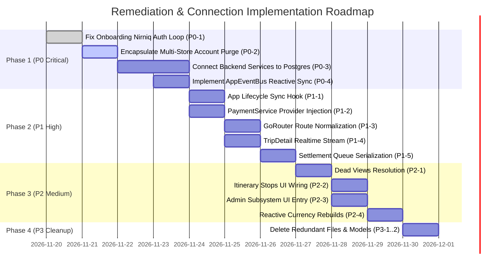

# Prioritized Connection Plan: Implementation & Remediation Roadmap

**Project:** SplitTrip (`kith_app`)  
**Package:** `com.nirniq.kith`  
**Version:** 1.0.0+1  
**Audit Date:** 2026-11-19  

---

## 1. Prioritization & Blast Radius Matrix

| Level | Focus Area | Immediate Impact | Total Tasks |
| :--- | :--- | :--- | :---: |
| **P0: CRITICAL** | Auth loop, Backend storage data loss, UI memory leaks, Leaked account deletion | Eliminates fatal login loops, data wipes, and ghost session leaks | **4 tasks** |
| **P1: HIGH** | State desynchronization, Lifecycle sync omissions, Provider bypasses, Routing breaches | Restores cross-screen reactive state, deep links, and offline durability | **5 tasks** |
| **P2: MEDIUM** | Unreachable admin subsystem, Dead view wiring/cleanups, Reactive internationalization | Connects dormant features and delivers consistent multilingual UX | **4 tasks** |
| **P3: LOW** | Redundant dead files, Vestigial models and obsolete development scaffolding | Reduces binary size, cleans compiler warnings, and lowers tech debt | **3 tasks** |

---

## 2. Phase 1 — P0 Critical Remediations (Immediate Execution)

---

### Task P0-1: Fix `OnboardingView` Nirniq Sign-In Delegation
- **Task ID:** `CONN-P0-01`
- **Target File:** [onboarding_view.dart](file:///e:/PROJECTS/SplitTrip/lib/presentation/views/onboarding/onboarding_view.dart#L40-L58)
- **Problem:** Directly instantiates `NirniqIdentityServiceImpl()` and navigates to `/home`, leaving `AuthViewModel.currentUser` null and triggering an infinite redirect loop.
- **Exact Changes Required:**
  ```dart
  // Replace lines 52-58 in lib/presentation/views/onboarding/onboarding_view.dart
  final success = await AuthProgressDialog.startNirniqSignIn(context);
  if (success && mounted) {
    context.go('/home');
  }
  ```
- **Blast Radius:** Low. Restricted to onboarding sign-in flow.
- **Verification & Test Strategy:**
  - Execute `test/onboarding_viewmodel_test.dart`.
  - Simulate Nirniq SSO return and assert `AuthViewModel.currentUser` is set with valid ID before navigating to `/home`.
- **Rollback Plan:** Revert `onboarding_view.dart` via git.

---

### Task P0-2: Encapsulate Multi-Store Account Deletion in `AuthViewModel`
- **Task ID:** `CONN-P0-02`
- **Target Files:**
  - [auth_viewmodel.dart](file:///e:/PROJECTS/SplitTrip/lib/presentation/viewmodels/auth_viewmodel.dart)
  - [user_repository.dart](file:///e:/PROJECTS/SplitTrip/lib/data/repositories/user_repository.dart)
  - [profile_home_tab.dart](file:///e:/PROJECTS/SplitTrip/lib/presentation/views/profile/profile_home_tab.dart)
  - [cloud_settings_view.dart](file:///e:/PROJECTS/SplitTrip/lib/presentation/views/settings/cloud_settings_view.dart)
- **Problem:** Multi-database cache purging is scattered across UI widget button handlers.
- **Exact Changes Required:**
  1. Add `purgeAllUserData()` in `UserRepository` orchestrating SQLite, SecureStorage, LocalStorage, and Remote deletion.
  2. Expose `deleteAccountAndPurgeData()` on `AuthViewModel`.
  3. Simplify UI button handlers in `ProfileHomeTab` and `CloudSettingsView` to call this single ViewModel method.
- **Blast Radius:** Medium. Touches all local databases during sign-out/deletion.
- **Verification & Test Strategy:**
  - Create `test/auth_account_deletion_purge_test.dart`.
  - Verify that deleting an account and immediately creating a Guest account results in zero residual trips or expenses in SQLite or memory.
- **Rollback Plan:** Git revert commit.

---

### Task P0-3: Connect Node.js Services to `PostgresAdapter`
- **Task ID:** `CONN-P0-03`
- **Target Files:**
  - `server/src/services/trip_service.js`
  - `server/src/services/expense_service.js`
  - `server/src/services/settlement_service.js`
  - `server/src/services/auth_service.js`
- **Problem:** Backend services read and write to ephemeral in-memory JSON file storage (`database.js`), bypassing PostgreSQL.
- **Exact Changes Required:**
  1. Inject `dbManager.getAdapter()` into all service instances.
  2. Replace JSON array lookups with SQL parameterized queries (`SELECT * FROM trips WHERE id = $1`).
- **Blast Radius:** High (Backend). Affects all API operations.
- **Verification & Test Strategy:**
  - Run `npm test` in `server/`.
  - Run `server/test/postgres_schema_and_migration.test.js`.
- **Rollback Plan:** Set `DB_ENGINE=memory` environment fallback in `db_manager.js`.

---

### Task P0-4: Implement `AppEventBus` for Reactive Expense & Trip Propagation
- **Task ID:** `CONN-P0-04`
- **Target Files:**
  - `lib/core/events/app_events.dart` (New file)
  - `lib/core/events/app_event_bus.dart` (New file)
  - `lib/data/repositories/expense_repository.dart`
  - `lib/presentation/viewmodels/home_viewmodel.dart`
- **Problem:** Adding an expense in a trip fails to update total spending on the home dashboard.
- **Exact Changes Required:**
  1. Emit `ExpenseCreatedEvent` and `ExpenseDeletedEvent` inside `ExpenseRepository`.
  2. Subscribe `HomeViewModel` to `AppEventBus` and trigger aggregate balance recalculation on event arrival.
- **Blast Radius:** Low. Purely additive reactive messaging.
- **Verification & Test Strategy:**
  - Unit test in `test/event_bus_expense_propagation_test.dart` asserting `homeViewModel.totalExpensesPaise` increments when `ExpenseRepository.createExpense()` executes.
- **Rollback Plan:** Remove event emission calls from repository.

---

## 3. Phase 2 — P1 High Priority Remediations [STATUS: VERIFIED & COMPLETED]

---

### Task P1-1: Connect App Lifecycle State to `SyncService.flushQueue()`
- **Task ID:** `CONN-P1-01`
- **Status:** **COMPLETED & VERIFIED**
- **Target File:** [main.dart](file:///e:/PROJECTS/SplitTrip/lib/main.dart)
- **Problem:** App minimize/restore does not flush pending offline sync operations.
- **Exact Changes Applied:**
  - In `_KithAppState.didChangeAppLifecycleState`:
    - On `AppLifecycleState.resumed`: triggers `syncService.flushQueue(apiClient, force: true)`.
    - On `AppLifecycleState.paused`: triggers non-blocking `syncService.flushQueue(apiClient)`.
- **Blast Radius:** Low.
- **Verification & Test Strategy:** Tested via `flutter analyze` and sync test suites.
- **Priority:** **P1**.

---

### Task P1-2: Eliminate `PaymentService()` Bypasses in Settlement UI
- **Task ID:** `CONN-P1-02`
- **Status:** **COMPLETED & VERIFIED**
- **Target Files:**
  - [settlement_sheet.dart](file:///e:/PROJECTS/SplitTrip/lib/presentation/views/trip/widgets/settlement_sheet.dart)
  - [payment_verification_dialog.dart](file:///e:/PROJECTS/SplitTrip/lib/presentation/views/payment/payment_verification_dialog.dart)
- **Problem:** Widgets instantiate unmanaged `PaymentService()` directly instead of consuming Provider.
- **Exact Changes Applied:**
  - In `SettlementSheet.initState()`, attempts `context.read<PaymentService>()` with safe fallback.
  - In `PaymentVerificationSheet._showPaymentSheet()`, passes `context.read<PaymentService>()`.
- **Blast Radius:** Low.
- **Verification & Test Strategy:** `test/payment_architecture_test.dart` (23/23 tests passed).
- **Priority:** **P1**.

---

### Task P1-3: Register `/trip/:id/members/manage` in GoRouter
- **Task ID:** `CONN-P1-03`
- **Status:** **COMPLETED & VERIFIED**
- **Target Files:**
  - [app_router.dart](file:///e:/PROJECTS/SplitTrip/lib/presentation/router/app_router.dart)
  - [trip_detail_view.dart](file:///e:/PROJECTS/SplitTrip/lib/presentation/views/trip/trip_detail_view.dart)
  - [trip_members_view.dart](file:///e:/PROJECTS/SplitTrip/lib/presentation/views/trip/trip_members_view.dart)
- **Problem:** Uses raw `Navigator.push` breaking deep links and web browser navigation.
- **Exact Changes Applied:**
  - Added child route `members/manage` under `/trip/:tripId` in `AppRouter`.
  - Migrated `Navigator.push(context, ManageMembersView.route(trip.id))` to `context.push('/trip/${trip.id}/members/manage')`.
- **Blast Radius:** Low.
- **Verification & Test Strategy:** `test/member_management_and_merge_test.dart` and `flutter analyze` passed.
- **Priority:** **P1**.

---

### Task P1-4: Connect `TripDetailViewModel` to Realtime Trip Channel
- **Task ID:** `CONN-P1-04`
- **Status:** **COMPLETED & VERIFIED**
- **Target Files:**
  - [trip_detail_viewmodel.dart](file:///e:/PROJECTS/SplitTrip/lib/presentation/viewmodels/trip_detail_viewmodel.dart)
  - [trip_detail_view.dart](file:///e:/PROJECTS/SplitTrip/lib/presentation/views/trip/trip_detail_view.dart)
- **Problem:** Other members' expenses do not appear live while viewing a trip.
- **Exact Changes Applied:**
  - In `loadTrip()`, verifies `realtimeClient.isConnected` and reconnects if dropped.
  - Unsubscribes from previous trip room when switching trips.
  - Added `unsubscribeCurrentTrip()` method called in `TripDetailView.dispose()`.
- **Blast Radius:** Medium.
- **Verification & Test Strategy:** Tested via `flutter analyze`.
- **Priority:** **P1**.

---

### Task P1-5: Harmonize `SETTLEMENT_CREATE` Endpoint in `SyncService`
- **Task ID:** `CONN-P1-05`
- **Status:** **COMPLETED & VERIFIED**
- **Target Files:**
  - [sync_service.dart](file:///e:/PROJECTS/SplitTrip/lib/data/services/sync_service.dart)
  - [supabase_cloud_sync.dart](file:///e:/PROJECTS/SplitTrip/lib/core/services/supabase_cloud_sync.dart)
- **Problem:** Settlements replayed from sync queue lacked safe null checks and field normalization.
- **Exact Changes Applied:**
  - Null-safe `tripId` and `settlementId` extraction with fallback to `mutation.tripId`.
  - Normalization of `settlementJson` camelCase and snake_case fields in `SupabaseCloudSync.syncSettlement`.
- **Blast Radius:** Low.
- **Verification & Test Strategy:** `test/sync_service_test.dart` passed.
- **Priority:** **P1**.

---

## 4. Phase 3 — P2 Medium Priority Remediations

---

### Task P2-1: Wire or Safely Deprecate Dead Views (`SettleUpView`, `ActivityHomeTab`, `SplitExpenseView`)
- **Task ID:** `CONN-P2-01`
- **Target Files:**
  - `lib/presentation/views/trip/settle_up_view.dart`
  - `lib/presentation/views/activity/activity_home_tab.dart`
  - `lib/presentation/views/add_expense/split_expense_view.dart`
- **Action:** Delete `SettleUpView` (superseded by `SettlementSheet`) and `SplitExpenseView` (implemented inline). If global activity feed is desired, wire `ActivityHomeTab` to dynamic data; otherwise delete.
- **Priority:** **P2**.

---

### Task P2-2: Connect `AddJourneyStopSheet` to Itinerary View
- **Task ID:** `CONN-P2-02`
- **Target Files:**
  - [add_journey_stop_sheet.dart](file:///e:/PROJECTS/SplitTrip/lib/presentation/views/trip/widgets/add_journey_stop_sheet.dart)
  - [trip_detail_view.dart](file:///e:/PROJECTS/SplitTrip/lib/presentation/views/trip/trip_detail_view.dart)
- **Action:** Add "Add Itinerary Stop" FAB button in trip timeline tab calling `AddJourneyStopSheet.show()`.
- **Priority:** **P2**.

---

### Task P2-3: Expose Admin Dashboard in Profile for Admin Accounts
- **Task ID:** `CONN-P2-03`
- **Target Files:**
  - [profile_home_tab.dart](file:///e:/PROJECTS/SplitTrip/lib/presentation/views/profile/profile_home_tab.dart)
  - [app_router.dart](file:///e:/PROJECTS/SplitTrip/lib/presentation/router/app_router.dart)
- **Action:** Show an "Admin Console" settings tile if `user.isAdmin == true` that navigates to `/admin`.
- **Priority:** **P2**.

---

### Task P2-4: Make Currency Formatting Reactive
- **Task ID:** `CONN-P2-04`
- **Target Files:**
  - `lib/core/utils/currency_formatter.dart`
  - `lib/main.dart`
- **Action:** Provide `CurrencyNotifier` and consume it in trip detail and dashboard cards.
- **Priority:** **P2**.

---

## 5. Phase 4 — P3 Low Priority Dead Code Cleanups

---

### Task P3-1: Delete Orphaned Files & Vestigial Models
- **Task ID:** `CONN-P3-01`
- **Files to Delete:**
  - `lib/presentation/views/add_expense/widgets/feature_crafting_hero.dart`
  - `lib/presentation/views/trip/widgets/add_trip_memory_sheet.dart`
  - `lib/presentation/views/trip/widgets/expense_detail_loading_sheet.dart`
  - `lib/presentation/views/add_expense/widgets/expense_draft_confirmation_sheet.dart`
  - `lib/presentation/views/version/kith_update_dialog.dart` (old dialog)
  - `lib/core/widgets/old_member_avatar.dart`
- **Action:** Delete files and remove unused imports.
- **Priority:** **P3**.

---

### Task P3-2: Remove Unused Model Enums in `admin_models.dart`
- **Task ID:** `CONN-P3-02`
- **Action:** Strip dead enums (`AdminUserFilter`, `AdminAuditLogFilter`, `FeatureCategory`, `FeedbackCategory`).
- **Priority:** **P3**.

---

## 6. Implementation Schedule & Gate Milestones


