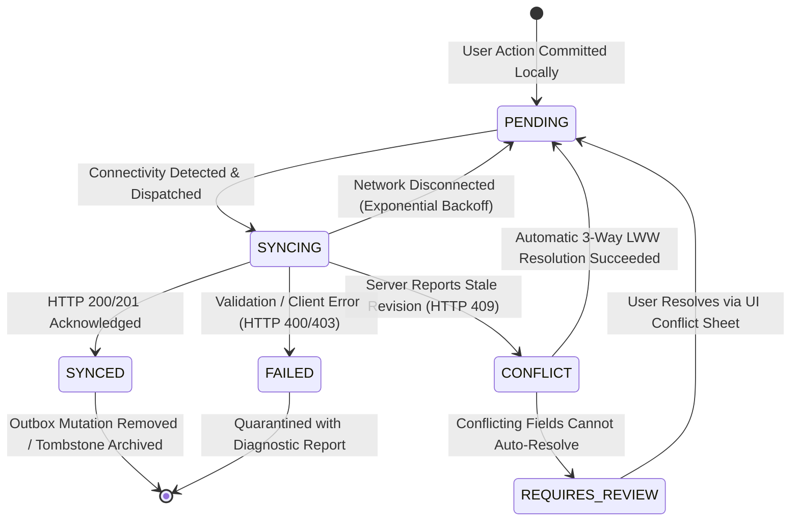

# Offline-First Synchronization Architecture

**Project:** SplitTrip (KITH)  
**Components:** `SyncService` (Client), `OperationSyncService` (Backend), SQLite WAL Outbox  
**Status:** Audit Completed & Hardened  

---

## 1. Synchronization Lifecycle & States

Every offline or online mutation is processed through a deterministic state machine:

### Supported Sync States:
1. **`PENDING`**: Mutation safely committed to SQLite `mutation_outbox`. Awaiting network dispatch.
2. **`SYNCING`**: Payload serialized, signed with session token, and in-flight to server.
3. **`SYNCED`**: Cloud authority verified and acknowledged; local cursor incremented.
4. **`FAILED`**: Non-retryable error (e.g. malformed data or permission revocation).
5. **`CONFLICT`**: Concurrent modification detected; revision tie-breaker triggered.
6. **`REQUIRES_REVIEW`**: Ambiguous multi-user collision presented to trip admin.

---

## 2. The 10 Core Offline Guarantees

1. **Local-First Write Invariant:** UI never blocks on network responses. Changes commit to local SQLite immediately.
2. **Durable Outbox Across Restarts:** Un-synced mutations reside in `mutation_outbox` table, surviving OS terminations and battery exhaustion.
3. **Deterministic Idempotency:** Every mutation assigns an immutable `idempotency_key` (typically the entity UUID v4). Replaying requests never creates duplicates.
4. **Exponential Backoff with Full Jitter:**
   $$\text{Delay} = \min(\text{MaxDelay}, \text{BaseDelay} \times 2^{\text{retryCount}}) \pm \text{Jitter}$$
   Prevents thundering herd on server recovery.
5. **Preservation of Unacknowledged Expenses:** Server snapshot refreshes never delete local expenses that have pending outbox mutations.
6. **Peer-to-Peer Nearby Connections Mesh:** In zero-internet environments, devices exchange mutations over BLE and Wi-Fi Direct. Merged with vector clocks.
7. **Safe Out-of-Order Deletion:** If a deletion arrives before an out-of-order creation, the creation is rejected if its timestamp precedes the tombstone.
8. **Monotonic Sequences:** PostgreSQL `kith_sync_events` sequence (`seq`) ensures clients only request deltas strictly greater than their local cursor.
9. **Zero Blind Overwrites:** Deletions operate via soft deletion (`is_deleted = true`) and explicit tombstones.
10. **Automatic Network Reconnection Listener:** `ConnectivityService` triggers an automatic queue drain upon network restoration.
