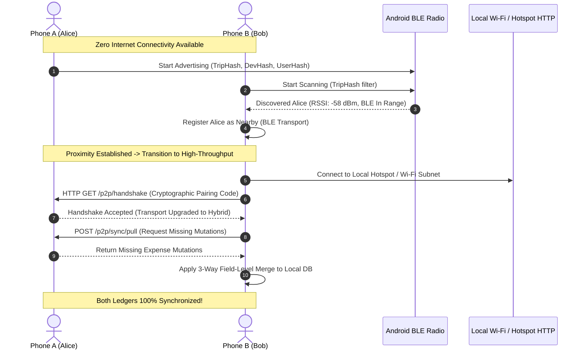

# Bluetooth Low Energy & P2P Mesh Architecture

## Overview

When groups travel in remote environments (such as high-altitude treks or national parks), internet connectivity is frequently completely absent. Kith implements a **zero-configuration, multi-transport peer-to-peer discovery and synchronization mesh** allowing nearby trip members to detect each other and exchange expense updates without cellular data or internet.

---

## 1. Multi-Transport Pipeline

---

## 2. Discovery vs Data Transfer Trade-off

1. **BLE Advertisement Limitations:** Standard Bluetooth 4.2/5.0 advertising frames limit custom service data to 24 usable bytes. While sufficient for proximity discovery, it cannot reliably transmit full multi-split expense payloads or receipt images.
2. **Hybrid Solution:**
   - **Phase 1 (Discovery):** Native Android BLE scanner and advertiser detect nearby members participating in the same trip within ~10–30 meters.
   - **Phase 2 (Transfer):** When high-speed transactional synchronization is needed, devices communicate over a shared Wi-Fi network or a phone's mobile hotspot using an embedded HTTP synchronization server running on port `54322+`.

---

## 3. BLE Advertisement Frame Format

Kith uses a dedicated 128-bit Service UUID: `3a8d9001-c817-48f9-b88a-36015b3c5801`.

The service data payload is packed into **18 bytes**:

| Byte Offset | Field Name | Data Type | Description |
| :---: | :--- | :--- | :--- |
| `0` | `protocolVersion` | `uint8` | Version identifier (currently `0x02`) |
| `1..4` | `tripTokenHash` | `int32` | 32-bit signed hash from SHA-256 of the 6-character trip invite code |
| `5..12` | `deviceIdHash` | `int64` | 64-bit signed hash from SHA-256 of the durable device ID |
| `13..16` | `userIdHash` | `int32` | 32-bit signed hash from SHA-256 of the authenticated user ID |
| `17` | `flags` | `uint8` | Bitmask flags: Bit 0 = Host, Bit 1 = Sync Available |

---

## 4. Privacy & Security Safeguards

- **No Sensitive Data in the Air:** No user names, expense titles, amounts, or financial details are broadcast in BLE advertisement packets.
- **Trip Authorization:** Beacons only match if both devices independently possess the trip invite code and compute the identical `tripTokenHash`.
- **Self-Exclusion:** The scanner discards any packet matching `localDeviceIdHash`, ensuring a broadcasting device never detects itself as a remote peer.
- **Battery Watchdog:** Advertisers and scanners automatically turn off after a 60-second inactivity watchdog to prevent battery drain.
