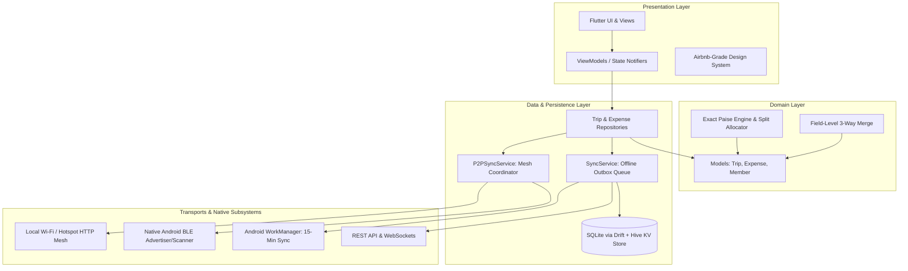

# Kith System Architecture Overview

Kith is architected as an **offline-first, multi-transport mobile application** with strict financial precision, zero-connectivity peer-to-peer discovery, and background cloud reconciliation.

---

## 1. Architectural Topology

---

## 2. Core Modules & Responsibilities

### 2.1 Presentation Layer (`lib/presentation/`)
- **Trip Views:** Trip dashboard, interactive members radar sheet, expense creation with split selectors, and settlement reconciliation sheets.
- **Design System:** Custom theme, haptic feedback integration, fluid 60fps animations, accessible contrast ratios, and dark/light adaptive surfaces.

### 2.2 Domain Layer (`lib/domain/`)
- **Exact Paise Arithmetic:** All monetary amounts are computed strictly in **integer paise** (`int amountInPaise`). Floating-point arithmetic is banned to prevent rounding errors across splits.
- **Fair Penny Allocation:** Splitting algorithms distribute remainders deterministically based on member sorting, ensuring $\sum \text{splits} \equiv \text{total}$ down to the last paise.
- **Field-Level 3-Way Merge (`expense_merge.dart`):** Merges concurrent offline edits to different fields of an expense (e.g. User A updates title while User B updates split amounts) without clobbering.

### 2.3 Data Layer (`lib/data/`)
- **`LocalStorageService`:** Dual-tier persistence leveraging SQLite (via Drift) for relational integrity and Hive for high-speed key-value caching.
- **`SyncService`:** Manages an offline mutation outbox queue. Implements exponential backoff, retry mechanisms, self-healing upserts on 404 responses, and device mutation auto-adoption across session upgrades.
- **`P2PSyncService`:** Coordinates peer discovery and bidirectional synchronization across local peer devices.

### 2.4 Native Android Subsystem (`android/`)
- **`KithBleManager.kt`:** Native Kotlin BLE advertiser and scanner bridging to Flutter via MethodChannel `com.nirniq.kith/ble_discovery`.
- **Background WorkManager:** Periodic 15-minute background synchronization worker maintaining data freshness even when the app is closed.
- **Android App Widgets:** Live interactive Glance/XML widgets for quick expense addition and budget tracking.
